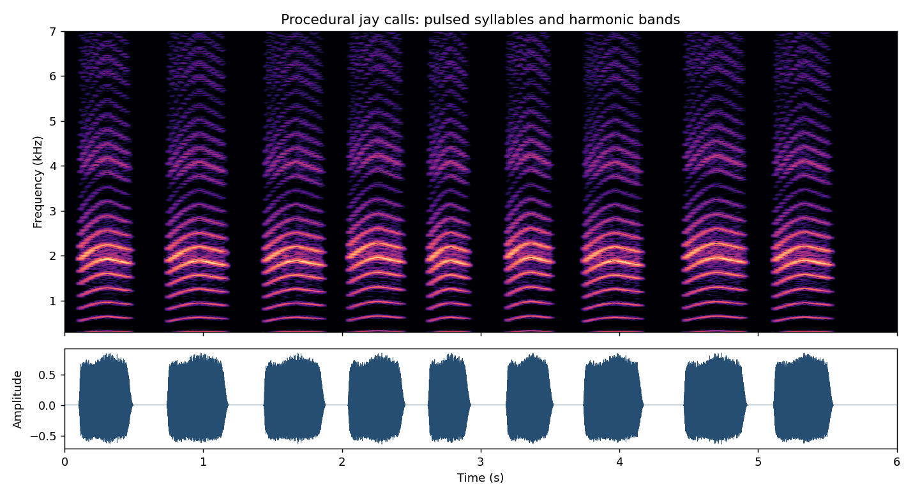

# Голос сойки

Трещание синтезируется в `jay-voice.js`. Это собственный процедурный звук;
полевые записи в игру не включены.

Источники для акустической структуры:

- [Willem C. Verboom, 2023: Bird vocalizations: calls of the Eurasian jay](https://www.researchgate.net/publication/369114081_Bird_vocalizations_calls_of_the_Eurasian_jay_Garrulus_glandarius). В разобранных автором семи криках: длительность 283–488 мс, около 300 импульсов/с, максимум энергии около 2 кГц. Частота повторения импульсов в одном примере растёт примерно от 270 до 320 Гц и заканчивается около 300 Гц. Это параметры конкретных записей, а не границы всех голосов вида.
- [Fraser Simpson: сонограммы и записи сойки](https://www.fssbirding.org.uk/eurasianjaysonogram.htm). Просмотрена сонограмма и проанализирована запись `jay113979ecut` из Австрии от 23 июня 2016 года: хриплые крики представляют собой отдельные слоги, а не стационарный шум.

Модель использует импульсное возбуждение затухающих резонансов около 2, 4 и
6 кГц, плавную огибающую и небольшую вариацию высоты. Частые слоги разделены
короткими паузами. Сохранено восьмибитное квантование амплитуды. Плотность
повторения выбрана для игровой сцены, акустическое воспроизведение приблизительное.
Прежний полосовой белый шум удалён. Мяуканье раз в 20 секунд не менялось.

